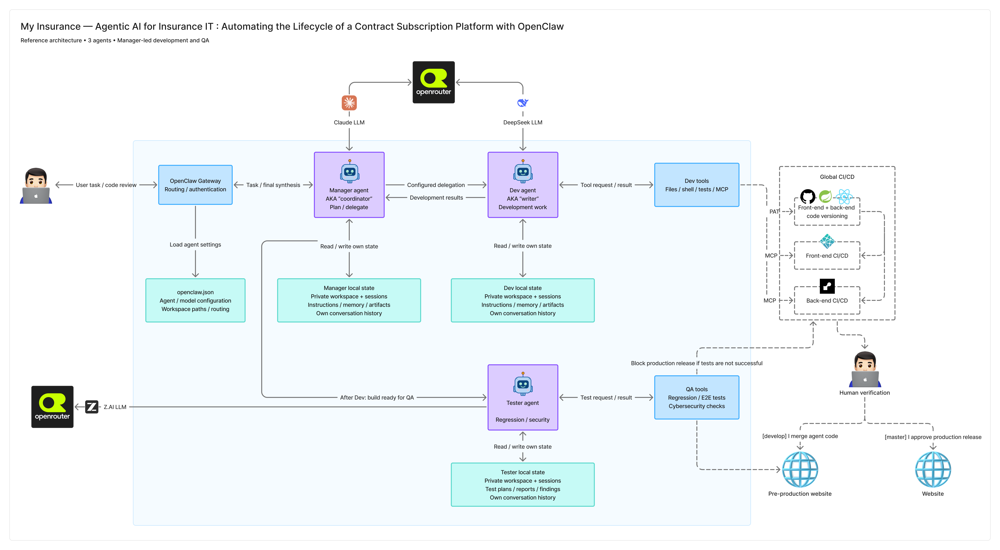
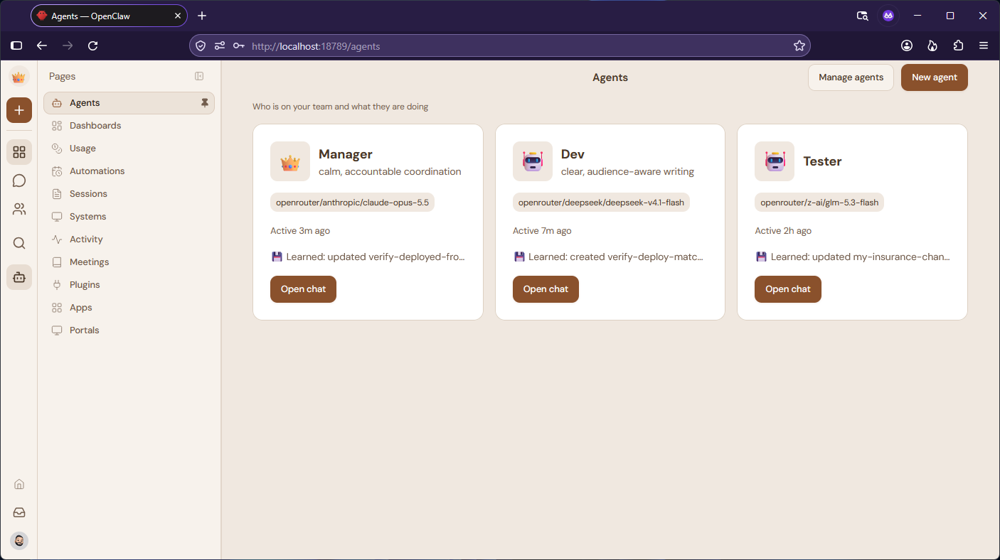
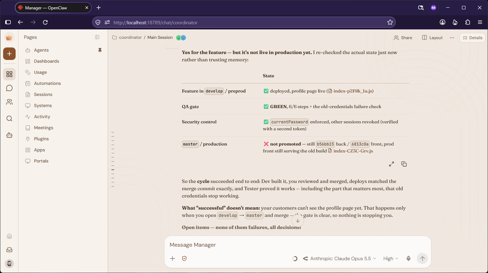
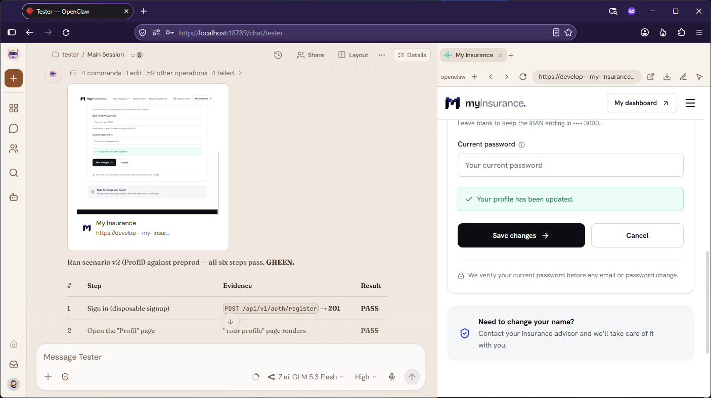

# My Insurance — Agentic AI for Insurance IT

**Automating the lifecycle of a contract subscription platform with OpenClaw**

A reference architecture for agentic software development: three specialised AI agents — coordinated by a Manager, with an independent QA gate — run the full lifecycle of a real insurance subscription platform, from feature branch to production release.

> Reference architecture · 3 agents · Manager-led development and QA

---

## Architecture



The diagram above is the whole story. A human operator talks to the **OpenClaw Gateway**, which routes the request to the **Manager** agent. The Manager plans, delegates to the **Dev** agent, and owns the final answer. The Dev agent works through real developer tools (files, shell, tests, MCP connectors) that drive GitHub, Netlify and Render. Once a build is ready, the Manager hands it to the **Tester** agent, whose independent security and regression verdict conditions the production release.

And then the loop closes on a person: **human verification** is the last step of the pipeline, not a formality. Whatever the agents produce, a human reads the code and takes the two decisions no agent is allowed to take — **merging into `develop`** and **approving the `develop` → `master` promotion**.

That only works if the work is legible. The whole design pushes the agents to show their evidence, so the human can *understand* what was done — not merely trust that it was done.

---

## What this repository demonstrates

| Concern | How it is handled here |
|---|---|
| **Single point of contact** | One Manager agent owns the outcome; the human never has to orchestrate specialists by hand. |
| **Separation of duties** | Dev writes code, Tester verifies it. The Tester cannot be invoked by Dev, only by the Manager. |
| **Human verification as the final step** | The cycle ends with a person, not a verdict. Agents never merge, approve, or promote — both release decisions stay human, and the gate is built around that. |
| **Independent QA gate** | No production promotion without a green Tester report, based on a UI-level scenario with per-step API evidence. |
| **Legible by construction** | The human must always be able to follow what the agents did and why. Every claim ships with its evidence — exact paths, status codes, deploy SHAs, explicit verdicts. |
| **Verified, not assumed** | Deployments are checked against commit SHAs and deploy metadata, never inferred from an HTTP 200. |
| **Durable agent memory** | Each agent keeps its own private workspace: instructions, memory, artifacts, and conversation history. |

---

## The team



| Agent | Internal id | Role | Model |
|---|---|---|---|
| 👑 **Manager** | `coordinator` | Single point of contact. Plans, delegates, verifies, and acts as the production gatekeeper. | `anthropic/claude-opus-5.5` |
| 🤖 **Dev** | `writer` | Implements features on a branch, opens the PR, and verifies the deployment after the merge. | `deepseek/deepseek-v4.1-flash` |
| 🤖 **Tester** | `tester` | Independent security review and end-to-end regression on preprod. Reports findings only. | `z-ai/glm-5.3-flash` |

All three run through **OpenRouter**, so each role can be matched to the model that fits it best — a reasoning-heavy model for coordination, a fast one for implementation, another for verification.

### Division of authority

- **Manager** — delegates, synthesises, and refuses a promotion while the gate is not green. Cannot merge.
- **Dev** — implements and inspects its own deployment. Cannot invoke Tester, cannot merge, cannot mark a PR ready.
- **Tester** — reports only. Never merges, approves, pushes, or touches production. Read-only and test-only access.
- **Human** — reviews the code, merges into `develop`, and approves the `develop` → `master` promotion.

---

## Lifecycle of a change



1. **Task intake** — the human states the outcome. The Manager identifies constraints and acceptance criteria, then delegates to Dev with a bounded brief.
2. **Implementation** — Dev works on a `feature/*` branch in the front and back repositories, running tests locally through the developer toolset.
3. **Pull request** — Dev opens one PR per feature into `develop`. Dev never merges it.
4. **Human review** — the human reviews the code. Feedback goes back through the Manager to Dev, who updates the PR.
5. **Merge into `develop`** — performed by the human. This is the trigger for QA.
6. **Deployment verification** — Dev confirms through the Netlify and Render MCP connectors that the deployed commit SHA matches the `develop` head. A green HTTP status is not proof; the deploy metadata is.
7. **QA on preprod** — the Manager hands the build to Tester, who runs the agreed regression scenario against the deployed preprod environment, UI-driven, with API traces as evidence per step.
8. **Gate verdict** — Tester renders `GREEN` or `NOT GREEN`. The Manager refuses the promotion while the gate is not green.
9. **Production promotion** — the human opens the `develop` → `master` PR and merges it. Batched cadence: one PR per feature into `develop`, promoted when there is enough to ship.
10. **Hotfix path** — `master` first, then merge `master` back into `develop`.

### The QA gate



**Green** is defined as:

- no critical or high security finding, **and**
- 100 % of the regression scenario steps pass.

The scenario is validated **at UI level**, with API traces as per-step evidence — an API-only smoke test can never make the gate green. Medium and low findings are documented but do not block.

The gate is currently **procedural**: GitHub Free does not allow rulesets on private repositories, so branch protection cannot enforce it technically. The Manager enforces it by refusing the promotion. Making it technical again is a one-line change once the repositories move to a paid plan (require the `tester/gate` status context on `master`).

### Human verification — the final, non-negotiable step

The cycle does **not** end with a green gate. It ends with a human.

**And you can only verify what you understand.** That is the first principle of this architecture: at every point, the human must be able to follow what the AI is doing, and why. Autonomy you cannot inspect is not autonomy you can trust — so legibility is a requirement, not a nice-to-have.

Even with a frontier reasoning model at the top of the stack — the Manager runs on Claude Opus 5.5 — the last step remains human. The operator reads the code, judges the trade-offs, and takes the two decisions no agent is allowed to take: merging the agent's code into `develop`, and approving the production release onto `master`.

Three reasons this step is not optional:

- **Accountability has to land somewhere.** An agent can *refuse* a promotion; it cannot be *accountable* for one. Someone has to sign.
- **A green gate proves the scenario passed — not that the right thing was built.** Tests verify what was specified. A human verifies that what was specified is worth shipping.
- **Model quality raises the floor, not the ceiling.** A stronger model reduces how often the human must intervene; it does not remove the need for judgement on scope, risk and timing.

### What keeps the work legible

The architecture is built so a human can always reconstruct what happened:

- **Artifacts are real files, at exact paths**, inside repositories the human already reviews — never opaque blobs in a hidden state.
- **Claims carry their evidence.** Not "it works", but `POST /api/v1/auth/register → 201`, the deployed commit SHA, the asset hash. Uncertainty is stated, not smoothed over.
- **Verdicts are explicit.** `GREEN` or `NOT GREEN`, with blocking items named. No implicit approvals.
- **The pass/fail criteria are the human's.** The regression scenario is written by the operator with the Tester, so the gate measures what the human actually cares about — never a test plan invented by the agent.
- **Sessions are inspectable.** The OpenClaw UI exposes each agent's reasoning and tool calls, not just its final answer.
- **`MEMORY.md` is a plain-text audit trail** — decisions with timestamps, verified facts, open questions, and risks. Readable, diffable, and reviewable by a person.

In this architecture, the human is not a bottleneck waiting to be automated away. They are the terminal verification step, and every other mechanism — the PR flow, the independent Tester, the evidence discipline, the procedural gate — exists to make that final review cheap, informed and trustworthy.

---

## Repository layout

```
.
├── doc/                          Architecture diagram and UI screenshots
│   ├── schema.png                Reference architecture (the diagram above)
│   ├── agents.png                OpenClaw Agents dashboard
│   ├── manager-agent.png         Manager session: verified cycle state
│   └── tester-agent.png          Tester session: regression scenario on preprod
├── openclaw/
│   ├── openclaw.json             Gateway config: agents, models, auth, MCP servers
│   └── workspace/
│       ├── coordinator/          Manager workspace
│       ├── writer/               Dev workspace
│       └── tester/               Tester workspace
└── README.md
```

Each workspace follows the same convention:

| File | Purpose |
|---|---|
| `AGENTS.md` | Operating program: scope, delegation rules, handoff contract, approval gates, memory hygiene. |
| `SOUL.md` | Personality and tone. |
| `IDENTITY.md` | Name, emoji, and theme of the agent. |
| `USER.md` | Durable directives about the human, loaded on every session. |
| `MEMORY.md` | Curated durable facts and decisions (main session only). |
| `memory/YYYY-MM-DD.md` | Raw daily notes. |

The **Manager's `MEMORY.md`** is the most interesting artifact in this repository: it is the running record of a real project — environments, verified endpoints, deployment evidence, decisions with their timestamps, open questions, and identified risks.

---

## Tooling and integrations

| Layer | Choice |
|---|---|
| Agent runtime | OpenClaw Gateway (local mode, token-authenticated, loopback-bound) |
| Models | OpenRouter — one model per role |
| Front-end CI/CD | Netlify, driven through the official Netlify MCP connector (OAuth) |
| Back-end CI/CD | Render, driven through the official Render MCP connector (API key from an environment variable) |
| Code versioning | GitHub, private repositories, OpenClaw-managed fine-grained PAT |
| Browser automation | OpenClaw-managed Chromium over CDP, used by Tester for UI-level runs |

A useful finding from this setup: **Render does not support OAuth dynamic client registration**, so the Render connector must be authenticated by API key. Netlify, by contrast, works with plain OAuth and leaves no secret on disk.

---

## The product under test

The platform itself is a home insurance subscription funnel — home first, car later.

- **Front end** — React 19 + Vite + Tailwind, plus an Express mock server for local development.
- **Back end** — Spring Boot, PostgreSQL, Liquibase migrations in YAML, OpenAPI specs describing each endpoint.
- **Auth** — opaque bearer token (not JWT) with a 12-hour TTL. Password rule: 5–15 characters with lowercase, uppercase and a digit. IBAN validated with MOD-97.
- **Pricing** — always computed server-side. Client-supplied premiums are ignored.

Monthly price (EUR):

```
base(plan) × coef(status) × coef(building year) × coef(age)
```

| Factor | Values |
|---|---|
| `status` | tenant `0.8` · owner `1.2` |
| `building year` | `< 1950` → `1.3` · `< 1990` → `1.1` · `< 2010` → `1.0` · otherwise `0.9` |
| `age` | `< 25` → `1.2` · `> 65` → `0.95` · otherwise `1.0` |

### Environments

| | Branch | Front | Back |
|---|---|---|---|
| Production | `master` | Netlify production site | Render service |
| Preproduction | `develop` | Netlify branch deploy | Separate Render service |

Preproduction is a **separate Render service**, not a second environment of the same project — Render does not allow multiple environments per project. This is why the gate runs on preprod: the scenario needs a deployed environment, and production is never touched by an agent.

---

## Lessons worth keeping

- **Verification is not suspicion.** The Manager re-checks every claim against its cited evidence before reporting completion. In practice this caught a real, single-root-cause production blocker that would otherwise have been reported as two unrelated failures.
- **Gate the deploy, not just the code.** The one blocking defect of the first cycle was a misconfigured build-time environment variable — the code was correct, the deployed bundle called the wrong API base. HTTP 200 on the homepage proved nothing.
- **Cold starts are a product problem.** A free-tier back end that sleeps produces 30–60 s first-request latency, which is fatal for a subscription funnel. This surfaced as a standing risk, not a test failure.
- **A procedural gate is a real gate only if someone owns it.** Agents can refuse; they cannot enforce. Naming the owner explicitly is what makes the rule hold.
- **Keep authority out of the agents' hands.** Neither Dev nor the Manager can merge or mark a PR ready. Everything that ships passes through a human.
- **The human step is a design goal, not a leftover.** A stronger model shrinks the time a human needs to review; it does not remove the review. Building the pipeline *around* that final check is what makes the autonomy safe to grant in the first place.
- **Explainability is the precondition for control.** You cannot approve what you cannot follow. Requiring agents to cite exact paths, status codes and evidence — and to state their uncertainty rather than smooth it over — is what turns a black box into something a human can actually sign off on.

---

## About this repository

This is a **sanitised** copy of the OpenClaw configuration and agent workspaces used to run the project. Credentials, tokens, host names, machine paths and infrastructure identifiers have been replaced with placeholders such as `<GATEWAY_AUTH_TOKEN>`, `<GITHUB_PAT>`, `<host-name>` and `C:\Users\<user>\`. Secrets are held in a vault and referenced from the environment, never written to the configuration.

The intent is to show the *shape* of the setup — roles, boundaries, memory, gate — not to be a turnkey deployment.
